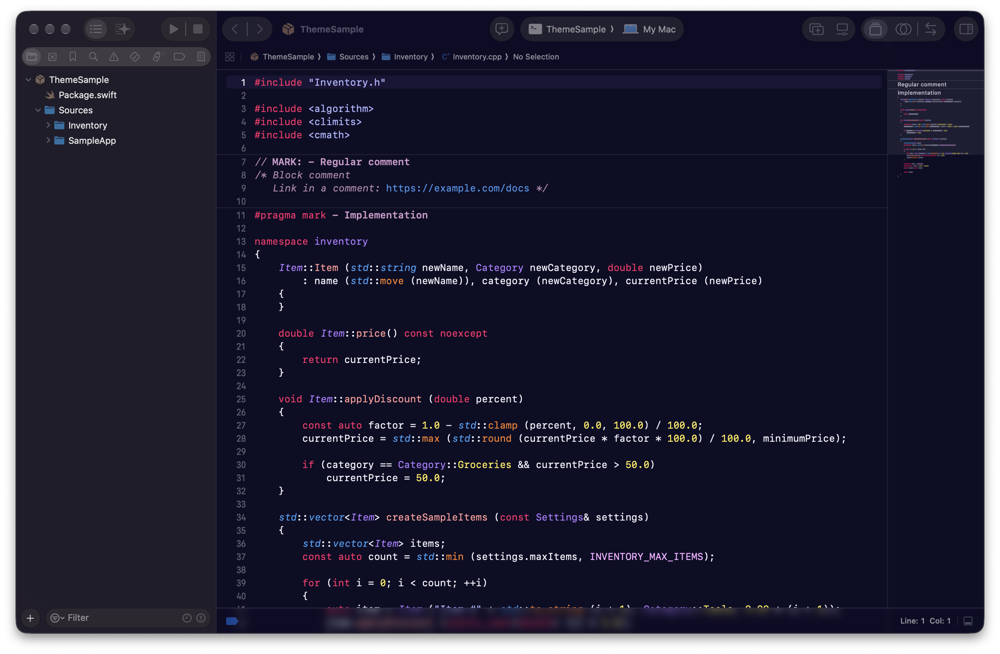
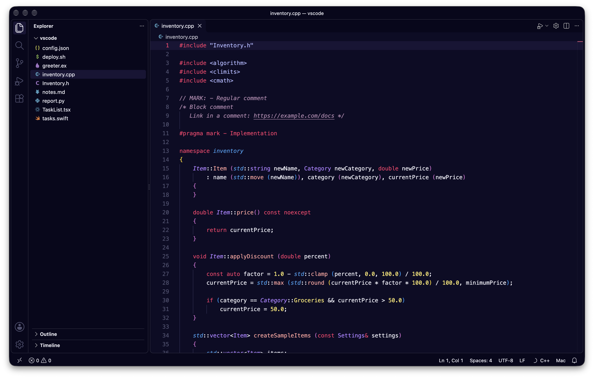

# 🍒 Midnight Cherry

[](#xcode-1)
[](#vs-code-1)
[](LICENSE)

A dark theme with cherry accents on a midnight-indigo background, for **Xcode**, **VS Code**, **Terminal.app**, **iTerm2** and **Ghostty**.

### Xcode



### VS Code



## Palette

<!-- palette:start -->
| Element | Hex | |
|---|---|---|
| Background | `#0e0c25` |  |
| Text | `#f1f1fa` |  |
| Keywords | `#ff376b` |  |
| Comments | `#b388af` |  |
| Strings | `#b0b7ff` |  |
| Numbers & enum cases | `#ffea6b` |  |
| Characters | `#ffc580` |  |
| Your types | `#ae80ff` |  |
| Library types | `#3e9eef` |  |
| Your functions | `#ffa09c` |  |
| Library functions | `#ff8f51` |  |
| Macros | `#f0aeff` |  |
| Library constants | `#51bcce` |  |
| Links | `#4495ea` |  |
| Selection | `#682146` |  |
| Cursor | `#ff5d82` |  |
<!-- palette:end -->

## Installation

### Xcode

1. Copy the theme file to Xcode's themes folder (create it if it doesn't exist):
   ```bash
   mkdir -p ~/Library/Developer/Xcode/UserData/FontAndColorThemes
   cp "xcode/Midnight Cherry.xcworkspacecolortheme" ~/Library/Developer/Xcode/UserData/FontAndColorThemes/
   ```
   - **Xcode 26 or later:** use `Midnight Cherry.xcworkspacecolortheme`.
   - **Older Xcode versions:** use `Midnight Cherry.xccolortheme` instead.
2. Quit Xcode completely (`⌘Q`) and open it again.
3. Select **Midnight Cherry** in **Settings → Appearance → Theme** (or **Settings → Themes** in older versions).

### VS Code

Copy the `vscode` folder into your extensions folder and reload VS Code:

```bash
cp -R vscode ~/.vscode/extensions/remaori.midnight-cherry-0.1.0
```

Then open the Command Palette (`⌘⇧P` / `Ctrl+Shift+P`) → **Preferences: Color Theme** → **Midnight Cherry**.

On Windows the extensions folder is `%USERPROFILE%\.vscode\extensions`.

Alternatively, package it as a `.vsix` and install it with **Extensions → … → Install from VSIX**:

```bash
cd vscode
npx @vscode/vsce package
```

### Terminal

- **Terminal.app:** double-click `terminal/Midnight Cherry.terminal`, then select **Midnight Cherry** in **Settings → Profiles** and click **Default**.
- **iTerm2:** open **Settings → Profiles → Colors → Color Presets… → Import…**, choose `terminal/Midnight Cherry.itermcolors`, then pick **Midnight Cherry** from the same menu.
- **Ghostty:** copy the theme into Ghostty's themes folder, then add `theme = Midnight Cherry` to your Ghostty config:
  ```bash
  mkdir -p ~/.config/ghostty/themes
  cp "terminal/ghostty/Midnight Cherry" ~/.config/ghostty/themes/
  ```

## License

[MIT](LICENSE)
