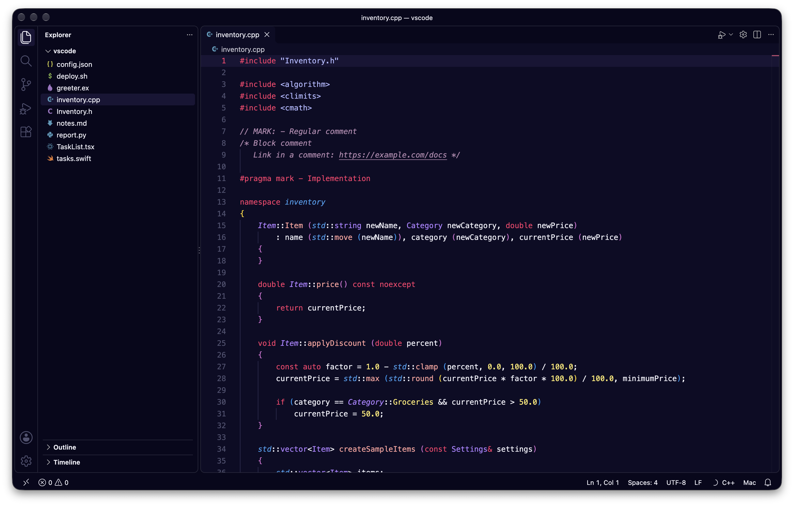

# Midnight Cherry

A dark theme with cherry accents on a midnight-indigo background.

## Palette

<!-- palette:start -->
| Element | Hex | |
|---|---|---|
| Background | `#0e0c25` |  |
| Text | `#f1f1fa` |  |
| Keywords | `#ff376b` |  |
| Comments | `#b388af` |  |
| Strings | `#b0b7ff` |  |
| Numbers & enum cases | `#ffea6b` |  |
| Characters | `#ffc580` |  |
| Your types | `#ae80ff` |  |
| Library types | `#3e9eef` |  |
| Your functions | `#ffa09c` |  |
| Library functions | `#ff8f51` |  |
| Macros | `#f0aeff` |  |
| Library constants | `#51bcce` |  |
| Links | `#4495ea` |  |
| Selection | `#682146` |  |
| Cursor | `#ff5d82` |  |
<!-- palette:end -->

## Usage

Open the Command Palette (`⌘⇧P` / `Ctrl+Shift+P`), run **Preferences: Color Theme** and pick **Midnight Cherry**.

## Also available for

Xcode, Terminal.app, iTerm2, Ghostty and Obsidian. See the [GitHub repository](https://github.com/Remaori/Midnight-Cherry-Theme).

## License

[MIT](LICENSE)
